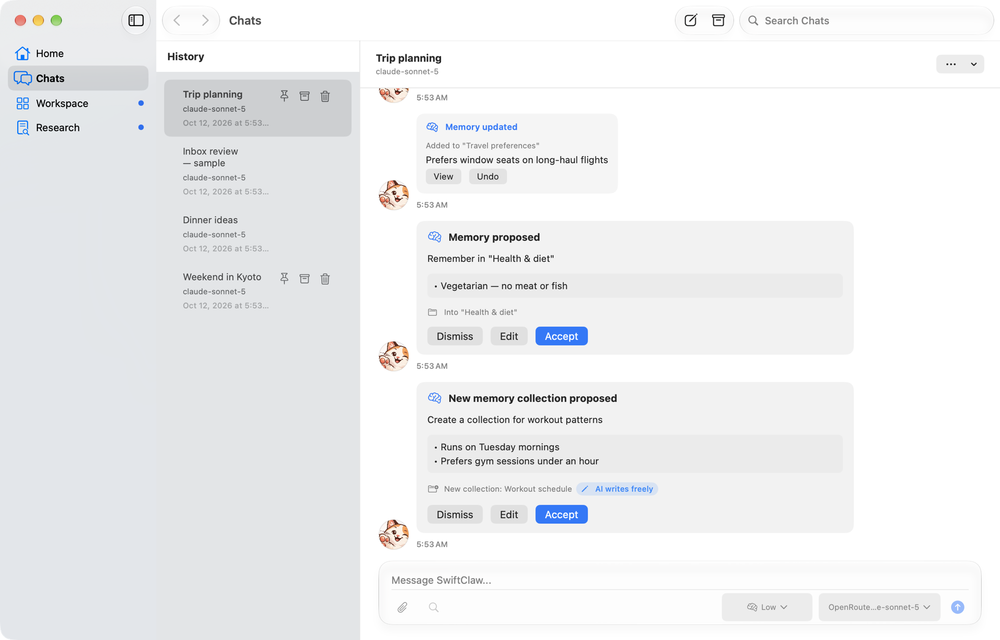
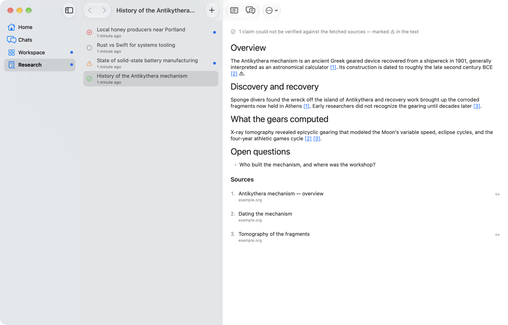
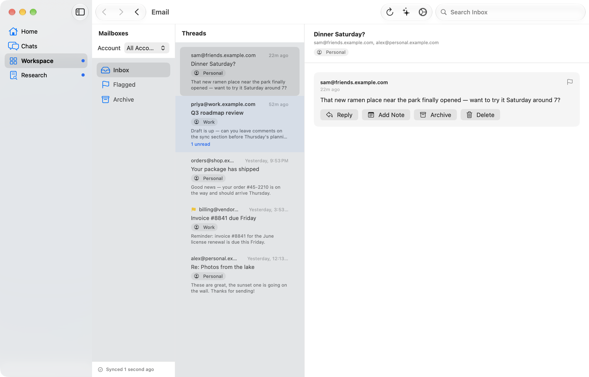
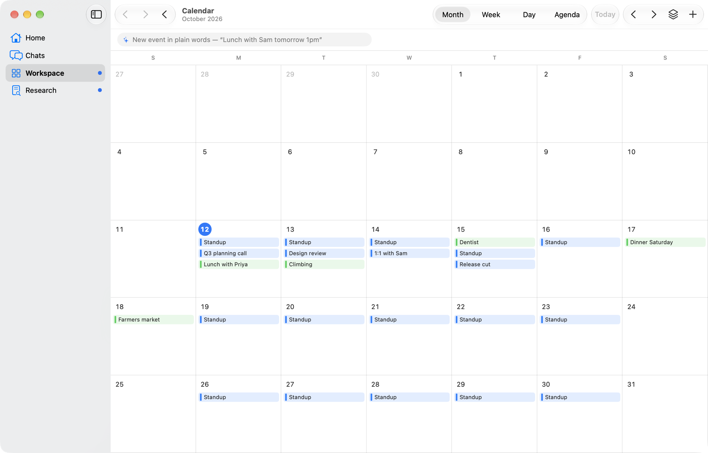
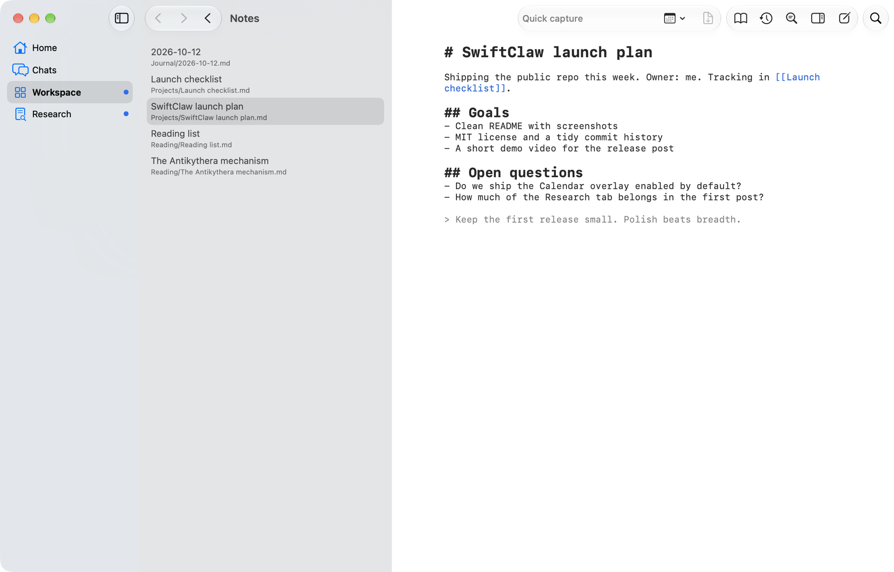
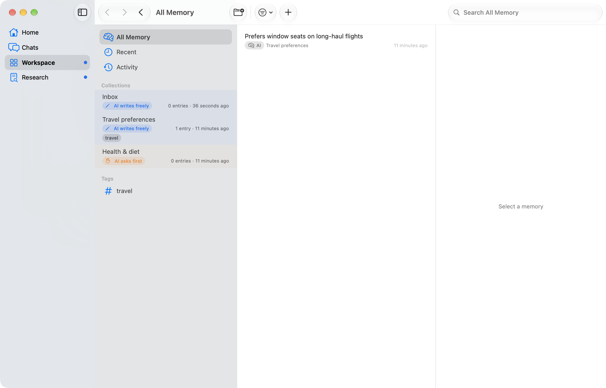
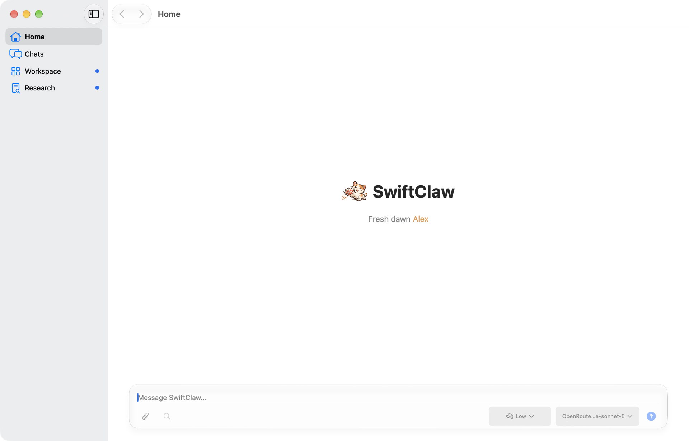
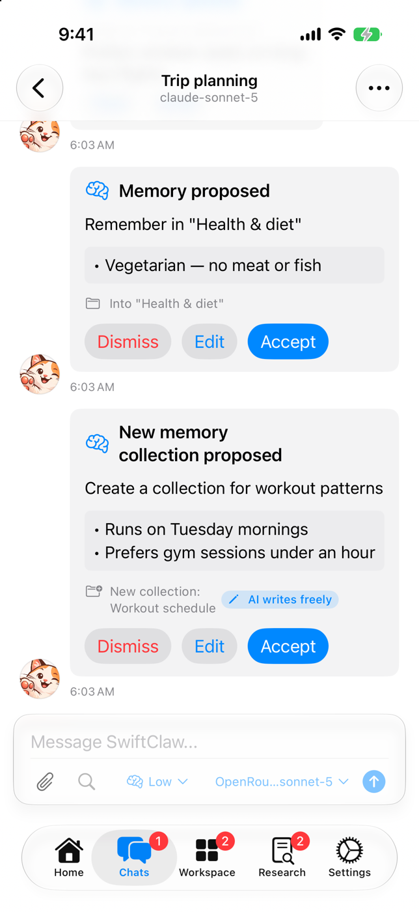
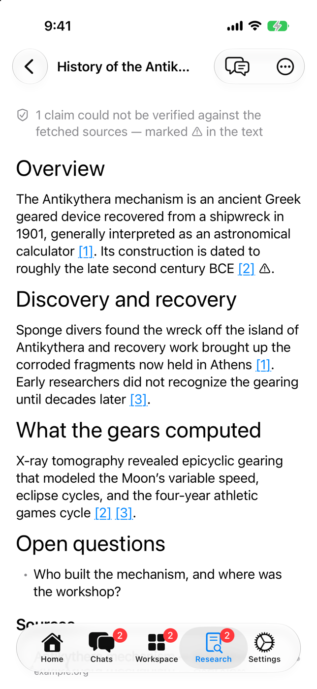

# SwiftClaw

A native AI assistant for macOS and iOS that works alongside your mail,
calendar, reminders, notes, and memory. You choose the model.



SwiftClaw is a SwiftUI + SwiftData app. The assistant can read your
workspace and propose changes to it. Anything that touches your data, such as
a note edit, a memory it isn't allowed to write freely, or an email action
from a review, is shown to you as a card to approve, edit, or dismiss.

> **Status:** a personal project under active development, shared as-is.
> There is no App Store build; you build it yourself with Xcode.

## Features

- **Chats.** Streaming Markdown conversations with image attachments, a
  per-chat model picker, and opt-in tools: web search, a quick in-chat
  *Investigation*, and read access to your notes.
- **Deep Research.** Long-running research sessions that run in the
  background. They plan, search, fetch sources, and write a cited report,
  and each claim is checked against the evidence it cites. Unsupported claims
  are flagged ⚠.
- **Email.** A multi-account IMAP/SMTP client with a unified inbox,
  threading, folder sync, replies, and a scheduled AI *Inbox Review* that
  summarizes what needs attention.
- **Calendar.** Month, week, day, and agenda views with recurrence, import
  from Apple Calendar and `.ics`, `.ics` export, event alerts, and an
  optional read-only Apple Calendar overlay.
- **Reminders.** Smart lists and your own lists, natural-language quick entry,
  roll-forward recurrence, import from Apple Reminders and `.ics`, and
  due-date alerts.
- **Notes.** A local-first Markdown vault. Plain `.md` files are the source of
  truth, so the same folder also opens in Obsidian or any editor. Notes has
  wikilinks, backlinks, hybrid search, quick capture, revision copies, and
  AI edits that wait for your approval.
- **Memory.** Collections of small facts that you and the assistant both
  curate. A per-collection access level decides whether the assistant writes
  directly, with one-tap undo, or asks first.
- **Reviews.** Email, Calendar, Reminders, and Notes each have a scheduled
  review that surfaces follow-ups as actionable cards in a chat.

## Screenshots

| | |
|---|---|
|  |  |
|  |  |
|  |  |

On iPhone:

<p>
  
  
</p>

The screenshots use the app's built-in DEBUG sample data. See
[Sample data](#sample-data).

## Requirements

- macOS 27 or iOS 27
- Xcode 27 (Swift 6.2 toolchain)
- An API key for at least one model provider: Azure OpenAI, Neuralwatt, or
  OpenRouter (any OpenAI-compatible model with tool calling works best)
- Optional: a [Brave Search API](https://brave.com/search/api/) key for web
  search, Investigation, and Deep Research

## Building

Open `SwiftClaw.xcodeproj` in Xcode, select the **SwiftClaw** scheme, and
run. To sign the app for your own machine or device, set your team under
*Signing & Capabilities* and change the bundle identifier
(`com.caffeineplz.SwiftClaw`) to one you own.

From the command line:

```sh
# Build the macOS app (unsigned)
xcodebuild -scheme SwiftClaw -destination 'platform=macOS' \
  -derivedDataPath /tmp/DerivedData CODE_SIGNING_ALLOWED=NO build

# Run the test suite (Swift Testing)
xcodebuild -scheme SwiftClaw -destination 'platform=macOS' \
  -derivedDataPath /tmp/DerivedData CODE_SIGNING_ALLOWED=NO test
```

If `xcode-select` points at the Command Line Tools, prefix the commands with
`DEVELOPER_DIR=/Applications/Xcode.app/Contents/Developer`.

The Xcode project uses synchronized folders, so new files under `SwiftClaw/`
are picked up automatically.

### iCloud sync

CloudKit sync for the calendar and reminders store is implemented but
switched off, because personal development teams can't carry iCloud
entitlements. On a paid team, restore the commented-out entitlements in
`SwiftClaw/SwiftClaw.entitlements` and change the container identifier. The
app picks up the synced store automatically.

## Getting started

1. Open **Settings → Providers**, add an API key, and list the models you
   want to use.
2. Pick models for the three tiers under **Settings → Model Behaviors**: the
   *Swift* model handles quick jobs like titles, the *Claw* model handles
   bigger and reasoning tasks, and the *Research* model drives Investigation
   and Deep Research.
3. Turn on the Workspace features you want under **Settings**. Email,
   Calendar, Reminders, Notes, and Memory are all off by default.

API keys and mail passwords are stored in the Keychain. Everything else stays
on your device, except the requests you send to the providers you configure.

## Sample data

DEBUG builds accept launch arguments that seed demo content, so you can
explore the UI without real accounts:

| Argument | Seeds |
|---|---|
| `-SwiftClawSeedSampleChats` | Two example conversations |
| `-SwiftClawSeedSampleEmails` | Two example mail accounts and an inbox |
| `-SwiftClawSeedSampleCalendar` | A week of events and two reminder lists |
| `-SwiftClawSeedMemoryCards` | Memory collections plus a chat with memory cards |
| `-research-fixture` | Deep Research sessions in each state |

`-SwiftClawInitialNavigationItem <home|chats|workspace|research>`,
`-SwiftClawInitialWorkspaceItem <email|calendar|reminders|notes|memory>`,
`-SwiftClawOpenNote <vault path>`, and `-research-fixture-open` jump straight
to a screen.

Seeders only write into an empty store. On iOS, a fresh simulator keeps demo
data separate. On macOS, the unsandboxed Debug build keeps its stores in
`~/Library/Application Support`, so give the demo its own bundle identifier
(for separate settings and Keychain items) *and* its own home directory:

```sh
xcodebuild -scheme SwiftClaw -destination 'platform=macOS' \
  -derivedDataPath /tmp/DerivedData-demo CODE_SIGNING_ALLOWED=NO \
  PRODUCT_BUNDLE_IDENTIFIER=com.example.SwiftClaw.Demo build
open -n --env HOME=/tmp/swiftclaw-demo \
  /tmp/DerivedData-demo/Build/Products/Debug/SwiftClaw.app \
  --args -SwiftClawSeedSampleChats -SwiftClawSeedSampleEmails -research-fixture
```

## Project layout

```
SwiftClaw/
  Features/   SwiftUI screens: Chats, Home, Email, Calendar, Reminders,
              Notes, Memory, DeepResearch, Workspace
  Services/   Inference, tools, research engine, mail client and sync,
              calendar/reminder logic, notes vault and search, memory
  Models/     SwiftData models
  Settings/   Settings UI, persisted settings, Keychain storage
  Shared/     App bootstrap, routing, logging, shared views
SwiftClawTests/   Swift Testing suites
docs/             Architecture, conventions, and per-feature design notes
```

Start with [`docs/architecture/OVERVIEW.md`](docs/architecture/OVERVIEW.md).
Each subsystem has a design doc under [`docs/features/`](docs/features), and
[`AGENTS.md`](AGENTS.md) is the working guide for coding agents and humans
alike.

## License

SwiftClaw is released under the [MIT License](LICENSE).
